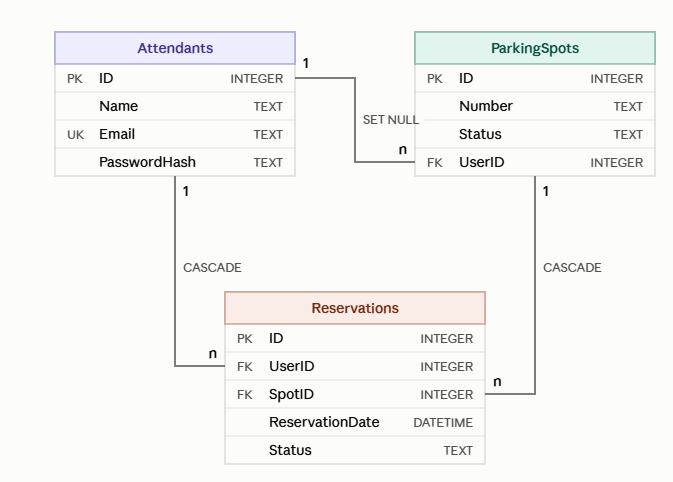

# ManagementSystem (Система управління парковкою)

Навчальний проєкт для лабораторних робіт: ASP.NET Core Web API / Admin + .NET MAUI Client.

## Предметна область
- **Users (Користувачі):** Attendants (Працівники парковки)
- **Items (Об'єкти):** ParkingSpots (Паркувальні місця)
- **Actions (Дії):** Reservations (Бронювання місць)
## Схема бази даних

```

## Структура проєкту
- `/Server/ServerApp` — веб-сервер на ASP.NET Core (.NET 8)
- `/Client/ClientApp` — кросплатформовий мобільний застосунок на .NET MAUI
- `/Database` — SQL-скрипти створення та ініціалізації БД (`init.sql`)

## Інструкція із запуску
1. **Сервер:** відкрити `Server/ServerApp/ServerApp.csproj` у Visual Studio та натиснути `F5` (HTTPS).
2. **Клієнт:** відкрити `Client/ClientApp/ClientApp.csproj`, обрати Android-емулятор або Windows Machine та натиснути `F5`.