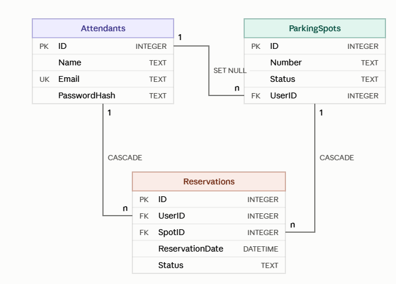
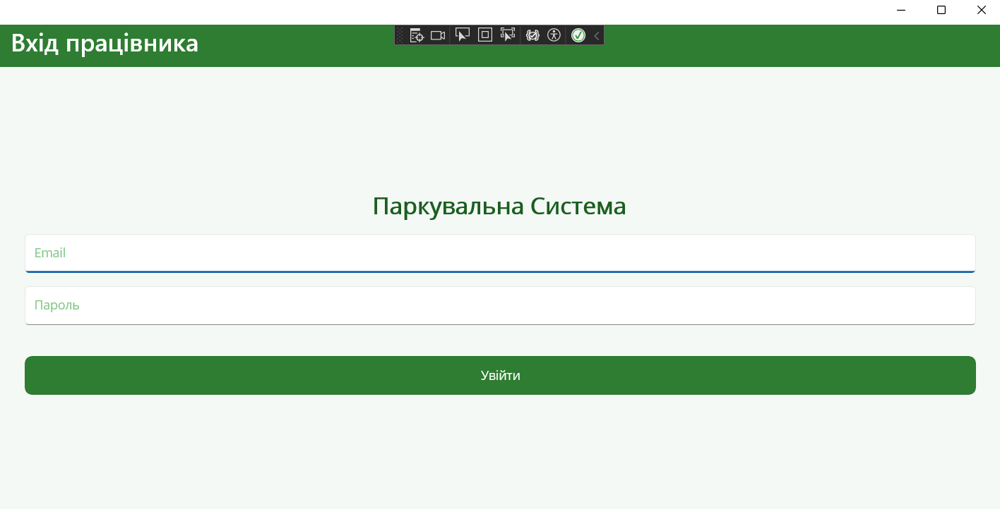
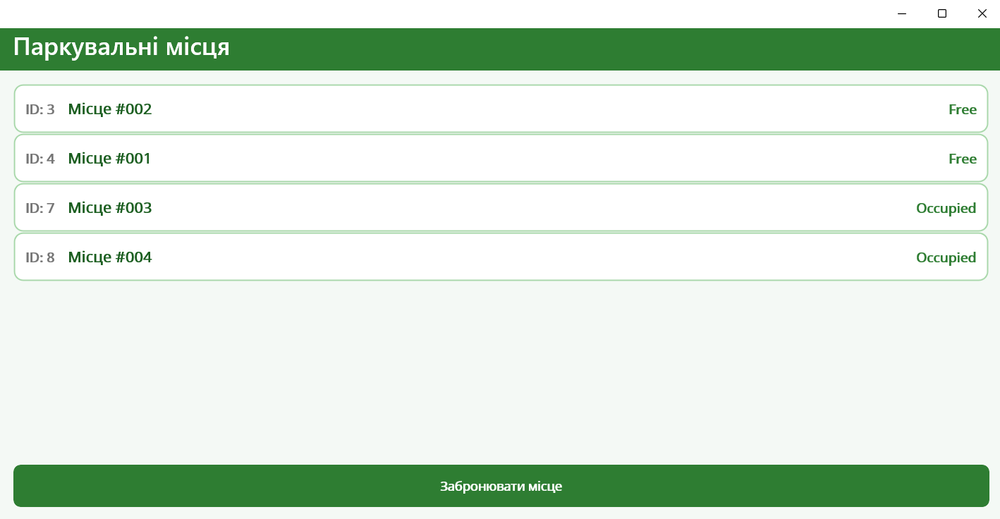
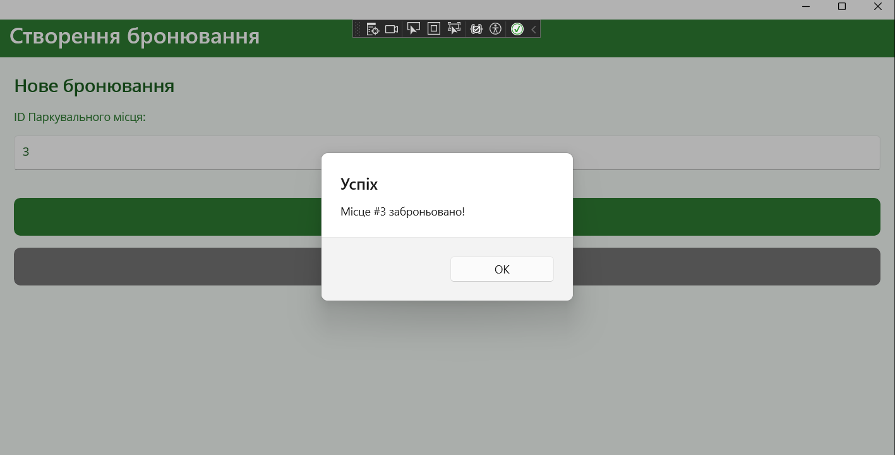
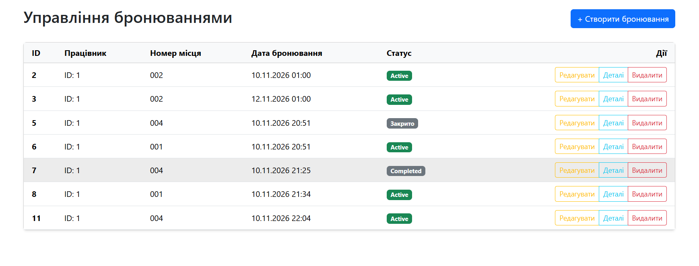

# ManagementSystem — Система управління парковкою

Навчальний проєкт: ASP.NET Core MVC-адмін-панель, REST API з JWT та мобільний застосунок на .NET MAUI (MVVM) для управління паркувальними місцями та їх бронюванням.

## Предметна область

| Загальна модель | Реалізація |
|---|---|
| Users | **Attendants** — працівники парковки |
| Items | **ParkingSpots** — паркувальні місця (Free / Occupied) |
| Actions | **Reservations** — бронювання місць |

**Сценарій:**
- Адміністратор через веб-панель виконує CRUD-операції над працівниками, місцями та бронюваннями.
- Працівник парковки через MAUI-застосунок входить у систему, бачить паркувальні місця та бронює вільні.

## Технології

- **Сервер:** .NET 8, ASP.NET Core MVC + Web API, Entity Framework Core, JWT, BCrypt, Swagger
- **Клієнт:** .NET MAUI, MVVM (CommunityToolkit.Mvvm), HttpClient, Preferences
- **БД:** SQLite (скрипт ініціалізації — `Database/init.sql`)

## Схема бази даних



Для прискорення вибірок додано індекси: `Attendants.Email` (унікальний), `Reservations.AttendantID`, `Reservations.SpotID`.

## Структура репозиторію

```text
ManagementSystem/
├── Server/ServerApp/        # ASP.NET Core: MVC-адмін-панель + REST API
│   ├── Controllers/         # MVC- та API-контролери
│   ├── Models/              # Сутності та AppDbContext
│   ├── Views/               # Razor-сторінки адмін-панелі
│   └── Program.cs           # DI, JWT, маршрутизація, Swagger
├── Client/ClientApp/        # .NET MAUI (MVVM)
│   ├── Views/               # LoginPage, ItemsPage, ActionPage
│   ├── ViewModels/          # LoginViewModel, ItemsViewModel, ActionViewModel
│   └── Services/            # ApiService (HttpClient + JWT)
├── Database/                # init.sql, schema.png
└── Docs/                    # init.sql, swagger.json, скріншоти
```

## Запуск

### 1. Сервер
1. Скопіювати `Server/ServerApp/appsettings.example.json` у `appsettings.json` і за потреби змінити рядок підключення та JWT-ключ.
2. Відкрити `Server/ServerApp/ServerApp.csproj` у Visual Studio 2022.
3. (За потреби) застосувати міграції: `Update-Database`.
4. Запустити (`F5`). Сервер працює на `https://localhost:7292`.
5. Адмін-панель: `https://localhost:7292/`. Swagger: `https://localhost:7292/swagger`.

### 2. Клієнт
1. У `Services/ApiService.cs` вказати адресу сервера:
   - Android-емулятор: `https://10.0.2.2:7292`
   - Windows Machine: `https://localhost:7292`
2. Відкрити `Client/ClientApp/ClientApp.csproj`, обрати Android-емулятор (API 33) або Windows Machine.
3. Запустити (`F5`).

## Автентифікація

| Хто | Де зберігаються дані | Як працює |
|---|---|---|
| Адміністратор | У коді (один обліковий запис) | Логін на сторінці адмін-панелі, JWT |
| Працівник парковки | Таблиця `Attendants` (пароль — BCrypt-хеш) | `POST /api/auth/login`, JWT зберігається в `Preferences` |

Тестові облікові дані (з `init.sql`):
- Адмін: `admin` / `ВАШ_ПАРОЛЬ`
- Працівник: `email@example.com` / `ВАШ_ПАРОЛЬ`

## REST API

| Метод | Ендпоінт | Опис | Авторизація |
|---|---|---|---|
| POST | `/api/auth/login` | Вхід, повертає JWT-токен | Ні |
| GET | `/api/items` | Список паркувальних місць | Bearer JWT |
| POST | `/api/actions` | Створення бронювання місця | Bearer JWT |

Токен передається в заголовку: `Authorization: Bearer <token>`.

Повна документація: Swagger UI (`/swagger`) та файл `Docs/swagger.json`.

## Сценарій роботи MAUI-застосунку

1. **LoginPage** — введення email і пароля, отримання JWT, збереження в `Preferences`.
2. **ItemsPage** — завантаження списку місць з API (список кешується у ViewModel).
3. **ActionPage** — вибір місця й підтвердження бронювання; після успіху список оновлюється.

## Скріншоти

| Вхід | Список місць | Бронювання | Адмін-панель |
|---|---|---|---|
|  |  |  |  |

## Автор

Ім'я Прізвище, група — лабораторні роботи з розробки кросплатформних та веб-застосунків.
